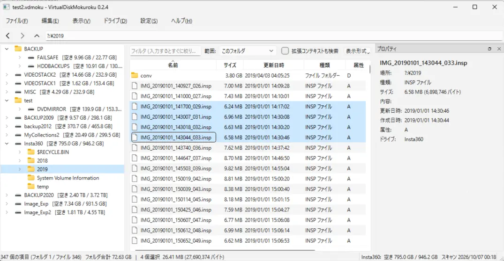
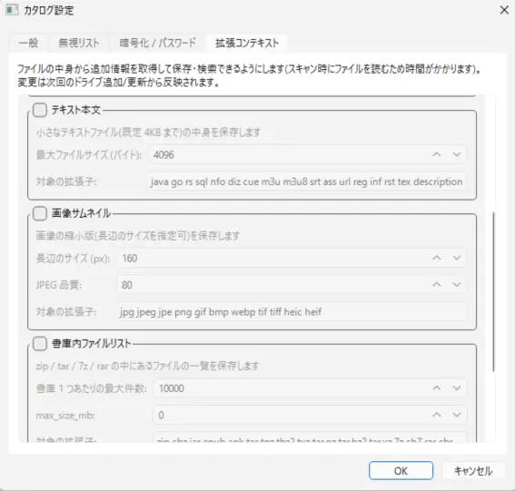

# VirtualDiskMokuroku

日本語 | [English](README.en.md)

CD/DVD・ポータブル HDD/SSD など任意のドライブのファイルリストをカタログ化し、ドライブを外した状態(オフライン)で
エクスプローラ風に閲覧・検索できる Windows 用ツールです。ファイルリストの取得には voidtools の Everything (es.exe) を利用します。

|スクリーンショット|拡張コンテキスト設定|
|---|---|
|||

## 必要なもの

- Windows 10 / 11、Python 3.12 以降
- PySide6 (`pip install PySide6`)
- カタログを暗号化する場合のみ: `pip install cryptography`
- Everything 本体と es.exe (同梱していません → [docs/Everything導入手順.md](docs/Everything導入手順.md))
- 拡張コンテキストを使う場合のみ: `pip install Pillow tinytag charset-normalizer olefile py7zr rarfile pycdlib`
  (無いライブラリに対応する項目だけが無効になります)

## 起動

```
VirtualDiskMokuroku.pyw をダブルクリック          (ソースツリーから直接起動)
python VirtualDiskMokuroku.pyw [カタログ.vdmoku]
```

`pip install -e .` でインストールした場合は `virtualdiskmokuroku` コマンドでも起動できます。

## 使い方

1. 「ファイル」→「新しいカタログ」でカタログファイル (`.vdmoku`) を作成
2. 「ドライブ」→「ドライブの追加 / 更新」でドライブを選んでスキャン
3. 以後はドライブを外していても、ツリーと一覧で中身を閲覧できます
4. ドライブの追加・更新などの変更は、「ファイル」→「カタログを保存」(Ctrl+S) でカタログに書き込みます
   (閉じるときに保存するか破棄するか選べます)

| 機能 | 操作 |
|---|---|
| フォルダ単位のサイズ集計 | 一覧のフォルダ行の「サイズ」列、ステータスバーの「フォルダ合計」 |
| ドライブの空き容量 | ツリーのドライブ名の横、ステータスバー右側(スキャン時点の値) |
| インクリメンタルフィルタ | 一覧上部の入力欄。範囲を「このフォルダ / 下位フォルダを含む / 全ドライブ」から選択。空白区切りで AND |
| 名前・フルパスのコピー | 一覧で選択して Ctrl+C / Ctrl+Shift+C、または右クリック |
| 一覧のエクスポート | Ctrl+E (テキスト または CSV。表示上限で打ち切られていても全件を書き出します) |
| サムネイル表示 | 一覧右上の「表示形式」(または「表示」メニュー) で「サムネイル (敷き詰め)」「サムネイル (情報付き)」に切替。画像サムネイルの保存を有効にしたカタログで使えます |
| 実際のフォルダを開く | 一覧またはツリーで右クリック →「このフォルダをエクスプローラで開く」。同じドライブが接続されているときだけ表示されます (ドライブレターが変わっていても可) |
| ドライブの更新 | ツリーでドライブを右クリック →「このドライブを更新」。ドライブレターが変わっていてもラベル・シリアルで同定します |
| ドライブのグループ分け | ツリーでドライブを右クリック →「グループを変更」(既存のグループを選ぶか、新しい名前を入力。空欄でグループから外す)。同じグループのドライブはツリーでまとめて表示されます。グループは 1 段だけで、ドライブが 1 台も無いグループは残りません。グループ名はグループを右クリックして変更できます |
| ドライブの整理 | 「ドライブ」→「ドライブの整理」。ツリー上でドラッグ & ドロップ (または「上へ / 下へ」) による並び替えとグループ間の移動、複数ドライブの一括削除、拡張コンテキスト (サムネイル・テキスト内容など) だけの削除ができます。並び替え・グループ・削除は OK を押したときにまとめてカタログへ書き込みます |
| ドライブを他のカタログにコピー | 「ドライブの整理」で選んで「他のカタログにコピー」。既存のカタログを選ぶとそこへ追加、新しいファイル名なら新規作成します (暗号化の有無が違っても可。バックアップ世代はコピーしません) |
| バックアップ世代 | 更新前のデータベースをカタログ内に保持 (既定 1 世代)。「ドライブ」→「バックアップから復元」 |
| 変更の保存 / 破棄 | 変更はカタログと同じフォルダの作業用コピー (`<名前>.vdmoku.editing`) に書かれ、「ファイル」→「カタログを保存」(Ctrl+S) で本体に反映します。「変更を破棄して読み直す」で最後に保存した状態に戻せます。閉じるときや別のカタログを開くとき (`.vdmoku` をウィンドウにドロップして開くときも) は、保存するか破棄するか尋ねます。「設定」→「アプリ設定」の「変更をすぐにカタログに保存する (自動保存)」をオンにすると、その場でカタログに書き込みます |
| カタログの暗号化 | 新規作成時に選択、または「設定」→「カタログ設定」→「暗号化 / パスワード」 |
| 無視リスト・拡張コンテキスト | 「設定」→「カタログ設定」(カタログごとに保存されます) |
| Virtual CD-ROM Case からの移行 (アルファ版) | 「ファイル」→「他のソフトのカタログをインポート」で `.cas` / `.caz` を選択 (圧縮して保存したものも可。[詳細](#virtual-cd-rom-case-のカタログのインポート-アルファ版)) |
| メディアステンシルからの移行 (アルファ版) | 「ファイル」→「他のソフトのカタログをインポート」で `.fsr` を選択 ([詳細](#メディアステンシルの記録ファイルのインポート-アルファ版)) |

### 拡張コンテキスト

カタログ設定で有効にした項目について、スキャン時にファイルの中身から追加情報を取得してカタログに保存します。
一覧でファイルを選ぶと「プロパティ」に表示され、「拡張コンテキストも検索」にチェックを入れるとフィルタの対象になります。

- EXIF (メーカー・カメラモデルなど) / Office 文書のメタ情報 / 音声・動画のタグ
- 小さなテキストファイルの中身 (文字コードを誤判定した場合は、プロパティで文字コードを指定して再取込できます。ドライブの再接続は不要です)
- 画像のサムネイル / 書庫 (zip, 7z, rar, tar) や ISO イメージ内のファイルリスト

### サムネイル表示

画像サムネイルを保存しているカタログでは、一覧をサムネイルで表示できます (サムネイルの無いファイルやフォルダはアイコンで表示)。

- **敷き詰め**: サムネイルを並べて表示。サムネイルの下に出す項目 (ファイル名・解像度・ファイル容量・更新日時) は
  「表示形式」→「敷き詰め表示でサムネイルの下に出す項目」で個別に切り替えられます
- **情報付き**: サムネイルの横に、名前・解像度・サイズ・更新日時・種類を表示
- **2 倍に拡大**: 保存してあるサムネイルを 2 倍に拡大して並べます (どちらの表示でも有効)
- 並べ替えは「表示形式」→「並べ替え」から行えます

解像度は元画像の幅 x 高さで、サムネイル取得時に保存します。この機能が入る前に作成したカタログでは、
ドライブを更新 (再スキャン) するとサムネイルを読み直して解像度が入ります。

再スキャン時は、前回から変わっていないファイルの結果を引き継ぐので読み直しは発生しません。
拡張コンテキストの取得中にキャンセルした場合は、取得できた分までを登録します。次回そのドライブを更新すると残りのファイルだけを取得します
(ファイルリストの取得中にキャンセルした場合は何も登録しません)。
読めなかったファイル (壊れている・ロックされている・対応していない形式など) はスキャン結果の「エラー」に数えられ、
スキャン画面の「エラーの詳細」ボタンで一覧を確認できます。一覧は `%APPDATA%\VirtualDiskMokuroku\logs\context-errors.log`
にも追記されます (暗号化カタログではファイル名を外に残さないため、ログには書きません)。

### カタログの暗号化

カタログの中身 (ファイル名・フォルダ構成・サムネイル・テキスト内容・ドライブの情報) をパスワードで暗号化できます。

- **設定**: 新しいカタログを作るときに選ぶか、「設定」→「カタログ設定」→「暗号化 / パスワード」で後から暗号化・解除できます。
  パスワードの変更は一瞬で終わります (中身を暗号化し直しません)
- **方式**: AES-256-GCM。パスワードからの鍵導出は scrypt。改ざんや破損は開くときに検出します
- **平文をディスクに書きません**: 閲覧時は復号した内容をメモリ上で開き、スキャンもメモリ上で行います。
  1 つのデータベースが上限 (既定 512MB。「設定」→「アプリ設定」で変更可) を超える場合だけ、
  `%LOCALAPPDATA%\VirtualDiskMokuroku\cache\session-*` に一時的に復号し、閉じるときに削除します
- **他のツールでは開けません**。「ファイル」→「復号して別のカタログに書き出す」で、暗号化しないカタログを取り出せます
- **パスワードを忘れると開けなくなります。** 復旧する方法はありません

暗号化で守れないもの:

- Everything 自身のインデックス (接続中のドライブのファイル名を Everything が保持しています)
- エクスポートしたファイル、クリップボードにコピーした内容
- 上限超過時の一時ファイルを削除した後のディスク上の痕跡、メモリやページファイルの内容
- 古い版 (暗号化に未対応) のアプリでは開けません。「新しいバージョンで作成されています」と表示されます

### Virtual CD-ROM Case のカタログのインポート (アルファ版)

> **この機能はアルファ版です。** Virtual CD-ROM Case 形式のファイルへの対応は調査中で、ファイルの構造は実際のファイルの
> 解析から推定しています。読めないファイルや、取り込まれない項目・誤って取り込まれる項目がある可能性があります。
> 取り込み後も元の `.cas` ファイルは残しておいてください。

Virtual CD-ROM Case のカタログ (`.cas` / `.caz`) に登録されているドライブを、開いているカタログへまとめて追加できます。
元のメディアが手元に無くても取り込めます。圧縮して保存したファイル (「casファイルを圧縮して保存する (Zlibにより圧縮)」の
`.cas` と、「常に圧縮して保存する (caz形式)」の `.caz`) もそのまま取り込めます (UNLHA32.DLL は不要です)。
`.caz` の展開には [7-Zip](https://7-zip.org/) がインストールされていればそれを使い、無ければ内蔵の展開処理を使います。
内蔵の展開処理は大きなファイル (数百 MB) では数十秒〜数分かかるので、7-Zip を入れておくと数秒で済みます。

Virtual CD-ROM Case 本体は下記からダウンロード可能で、Windows 11 でも動作します。

- <http://www.hi-ho.ne.jp/hiro30/soft.html>
- <https://www.vector.co.jp/soft/win95/util/se078992.html>

取り込みの内容は次のとおりです。

- 取り込むもの: フォルダ構成・サイズ・更新日時・作成日時・属性、ボリュームのラベル・シリアル・形式・容量・空き
- ファイルやフォルダのコメントは「テキスト内容」として、分類・プロパティ (HTML のタイトル、実行ファイルのバージョン情報、
  PDF の文書情報、AVI のタグ情報など)・CRC32 はメタ情報として取り込み、「拡張コンテキストも検索」で検索できます。コメントが
  文字化けしている場合は、プロパティで文字コードを指定して読み直せます。ドライブの分類は「ドライブ情報」に表示されます
- 中身を展開して登録していた書庫 (ZIP・LZH・RAR など) は、このアプリでスキャンした場合と同じく 1 つのファイルとして
  取り込み、中身は「書庫 / イメージ内のファイルリスト」に入ります (名前・サイズ・更新日時。「拡張コンテキストも検索」の
  対象)。書庫内の各ファイルの CRC は取り込みません
- グループ (フォルダ) にまとめて登録していたドライブは、同じ名前のグループに入った状態で取り込みます。
  グループは 1 段だけなので、グループが入れ子になっていた場合は最も外側のグループに入ります
  (グループのコメントは「ドライブ情報」に表示されます)
- `.cas` にはドライブレターが記録されていないため、場所は `?:\` で始まる表示になります
- 取り込んだドライブは常に新しいドライブとして追加されます。あとで実物を接続して「このドライブを更新」すると、
  ラベル・シリアルで同じドライブとして更新できます (更新すると、取り込んだコメントは引き継がれません)
- `.cas` の仕様は公開されていないため、実際のファイル (形式バージョン 12 と、2001 年ごろの版が書いた 9) の解析に
  基づいて読んでいます。意味の分からない項目は取り込みません。読めない場合はカタログを変更せずにエラーを表示します

### メディアステンシルの記録ファイルのインポート (アルファ版)

> **この機能はアルファ版です。** メディアステンシル形式のファイルへの対応は、Version 3.20 で記録した実際のファイルの
> 解析から推定した構造に基づいています。読めないファイルや、取り込まれない項目・誤って取り込まれる項目がある可能性が
> あります。取り込み後も元の `.fsr` ファイルは残しておいてください。

メディアステンシル (工房 和泉家) の記録ファイル (`.fsr`) に記録されているメディアを、開いているカタログへまとめて
追加できます。「ファイル」→「他のソフトのカタログをインポート」で `.fsr` を選択してください (Virtual CD-ROM Case の
`.cas` と同じメニューで、形式はファイルの中身から判定します)。

- <http://www.eva.hi-ho.ne.jp/izumiya/stencil/index.html>

取り込みの内容は次のとおりです。

- 取り込むもの: フォルダ構成・サイズ・更新日時・属性、ボリュームのラベル・シリアル・ドライブの種類、記録した日時
  (ドライブの「スキャン日時」になります)、使用量 (メタ情報 `stencil_used_bytes`)。容量と空き容量は記録されていません
- 「名前の変更」で付けた名前はドライブの表示名に、「プロパティ」のコメントは「ドライブ情報」のコメントになります
- 「アイコン情報も読み取る」で記録されたファイルのアイコン (16 色、32x32) は、そのファイルのサムネイルとして取り込みます。
  「プロパティ」とサムネイル表示で見られます。記録されていないファイル (関連付けのアイコンで表示されていたもの) には
  何も付きません
- 「書庫ファイルの内容も読み取る」で記録された CAB・LZH の中身は、このアプリでスキャンした場合と同じく、書庫を 1 つの
  ファイルとして取り込み、中身は「書庫 / イメージ内のファイルリスト」に入ります (名前・サイズ・更新日時。
  「拡張コンテキストも検索」の対象)
- フォルダ単位で記録したものは、場所が `?:\フォルダのパス` で始まるドライブになります (ドライブ全体なら `?:\`。
  `.fsr` にはドライブレターが記録されていません)
- 取り込んだドライブは常に新しいドライブとして追加されます。あとで実物を接続して「このドライブを更新」すると、
  ラベル・シリアルで同じドライブとして更新できます (更新すると、取り込んだアイコンは引き継がれません)
- `.fsr` の仕様は公開されていないため、実際のファイル (形式バージョン 1.00、メディアステンシル 3.20) の解析に基づいて
  読んでいます。意味の分からない項目は取り込みません。読めない場合はカタログを変更せずにエラーを表示します

## 表示言語

Windows の表示言語が日本語なら日本語、それ以外の環境では英語で表示します。「設定」→「アプリ設定」の
「表示言語」で固定することもできます (次回の起動から反映)。環境変数 `VIRTUALDISKMOKUROKU_LANG` に `ja` または `en` を
設定すると、設定より優先してその言語になります (動作確認用)。

## コマンドライン

```
virtualdiskmokuroku volumes                         接続中のボリューム一覧
virtualdiskmokuroku scan E:\ my.vdmoku [--name 名前] スキャンして追加/更新 (カタログが無ければ作成)
virtualdiskmokuroku scan E:\ my.vdmoku --encrypt --password ****   暗号化カタログとして新規作成
virtualdiskmokuroku list my.vdmoku                   カタログ内のドライブ一覧
virtualdiskmokuroku find my.vdmoku 語1 語2           全ドライブを名前で検索
virtualdiskmokuroku import old.cas my.vdmoku         Virtual CD-ROM Case のカタログ (.cas / .caz) かメディアステンシルの記録ファイル (.fsr) を取り込む (アルファ版。カタログが無ければ作成)
```

ソースツリーから実行する場合は `python VirtualDiskMokuroku.pyw scan ...` としてください。

## カタログファイルの構造

`.vdmoku` は ZIP 書庫です。ドライブごとに SQLite データベースを持ち、更新時はドライブ単位で作り直します。

```
manifest.json                             カタログ設定とドライブ一覧
drives/<id>/files.db                      ファイル基本情報
drives/<id>/context.db                    拡張コンテキスト (有効時のみ)
drives/<id>/backup/<日時>/...             旧世代
```

旧名 PyMediaCatalogue で作成した `.pmcat` ファイルもそのまま開けます。

閲覧時は必要なデータベースだけを `%LOCALAPPDATA%\VirtualDiskMokuroku\cache` に展開して開きます。
自動保存がオフのとき、保存前の変更は同じフォルダの `<名前>.vdmoku.editing` に書かれ、保存するとこのファイルで本体を
差し替えます (異常終了などで残った `.editing` ファイルは削除して構いません)。

## 制限事項

- 「パスワードの確認のみ (暗号化なし)」の保護は、このアプリで開くときに確認するだけです。ZIP として展開すれば中身を読めるので、中身を守りたい場合は暗号化を使ってください。
- フィルタの大文字小文字無視は半角英字のみです (全角英字やアクセント付き文字は区別されます)。
- Everything が作成日時・属性をインデックスしていないと、スキャンに時間がかかります → [docs/Everything導入手順.md](docs/Everything導入手順.md) の 5 章
- バックアップ世代間の差分比較は未実装です (将来対応)。

## 開発

```
python -m pytest -q
```

## ライセンス

[MIT License](LICENSE)

配布用の実行ファイルに同梱される Qt / PySide6 (LGPL) などのライセンスは [THIRD-PARTY-NOTICES.md](THIRD-PARTY-NOTICES.md) と `licenses/` にあります。
